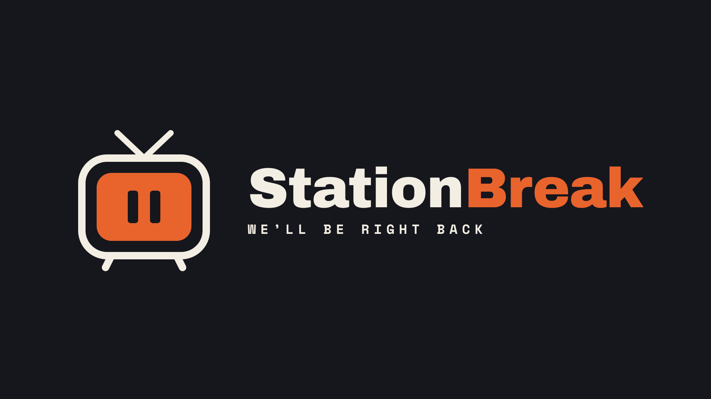

# StationBreak

Turn your Jellyfin library into always-on, flip-through broadcast channels on Fire TV and Android TV.

> **Status:** Phase 0 (Foundations). The module skeleton (convention plugins, the Kotlin Multiplatform shared core
> and the day-one modules) builds and is checked in CI (GitHub Actions). The Jellyfin adapter (server address, sign-in,
> Quick Connect, libraries, items, playback info and reporting) is built and tested against real servers in Docker, and
> bound in the app with Hilt; no screen uses it yet.

## Docs

| Doc | What's in it |
| --- | --- |
| [Spec](docs/SPEC.md) | Vision, goals, architecture, MVP scope (source of truth) |
| [Epics](docs/EPICS.md) | One epic per roadmap phase, with its gate as acceptance criteria |
| [Backlog](docs/BACKLOG.md) | Features and user stories with testable acceptance criteria |
| [Roadmap](docs/ROADMAP.md) | Phase sequencing, dependencies, spikes, risks |
| [Modules](docs/MODULES.md) | Gradle module layout |
| [Rules format](docs/rules-format.md) | The channel rules file: schema, examples and the exact ordering algorithms, for other clients |
| [Assumptions & questions](docs/ASSUMPTIONS.md) | What's been assumed, decided, and still open |
| [ADRs](docs/adr/) | Architecture decision records |
| [Playback matrix](docs/compatibility/playback-matrix.md) | What the player did with a spread of files on real Fire TV devices, measured on device |

The playback matrix is produced by the tooling in `scripts/playback-matrix/`.

## Assets

The TV banner, the launcher icons and the banner at the top of this README are **placeholders**, not final brand art.
They come from the "StationBreak Logo" design canvas: the sign-off test card is the app icon and, widened to 16:9, the
TV banner; the TV mark and wordmark are the README banner. The SVG sources are in `art/placeholder/`, and
`scripts/render-placeholder-art.sh <font-dir>` renders every PNG at its exact size. The text is set in Archivo Black
and Space Mono Bold (both SIL OFL 1.1, from `github.com/google/fonts`); no font file is shipped.

## Contributing

See [CONTRIBUTING.md](CONTRIBUTING.md). Contributions require a DCO sign-off (`git commit -s`). Everyone taking
part follows the [Code of Conduct](CODE_OF_CONDUCT.md). Report security vulnerabilities privately as described in
[SECURITY.md](SECURITY.md).

## License

GPL-3.0-or-later with an app-store additional permission: see [LICENSE](LICENSE) and
[ADR-0003](docs/adr/0003-licensing-and-contributions.md).
