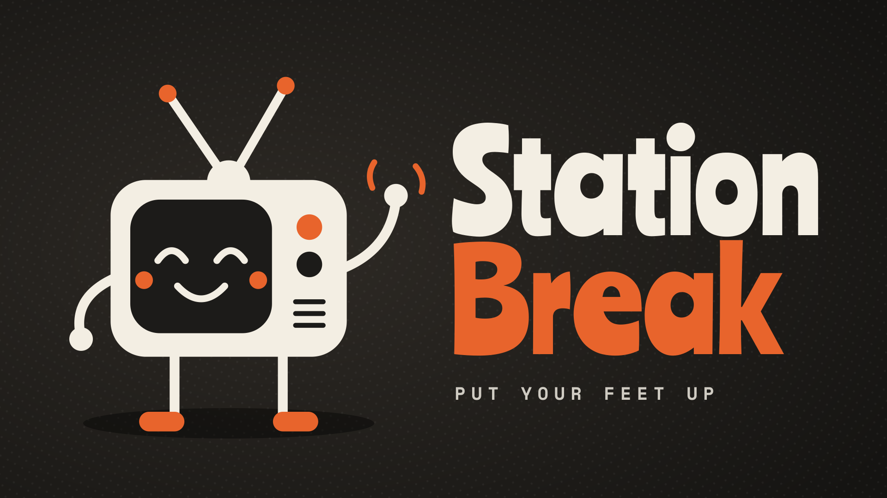

# StationBreak

StationBreak turns your own Jellyfin library into live TV. Your shows and films play on a schedule across themed
channels, the way cable does: turn it on and something is already playing. Flip channels, browse a program guide,
and build a few channels of your own.

It plays only your own media, from your own Jellyfin server (12.0 or later). It has no content of its own, no ads and
no tracking.

## Fire TV first

StationBreak is made for Fire TV, on Fire OS 6 or later, and works with the remote alone.

**Amazon Appstore:** coming soon. The link goes here when the listing is live.
<!-- AMAZON APPSTORE LISTING URL: replace the line above with a link once the listing is published. -->

Until then, see [Install](guide/install.md) for what you need.

## Guide

| Page | What's in it |
| --- | --- |
| [Install](guide/install.md) | What you need, and how to get the app onto a Fire TV |
| [Set up your server](guide/server-setup.md) | Jellyfin version, connecting, signing in, choosing libraries |
| [Reverse proxies](guide/reverse-proxy.md) | Serving Jellyfin under a path such as `/jellyfin`, and what the app expects |
| [Certificates and http](guide/certificates.md) | Plain http at home, Let's Encrypt, and self-signed certificates |
| [Channels](guide/channels.md) | The built-in channels, switching channels on and off, numbers, and building your own |
| [Mature content and kids](guide/mature-content.md) | What the app filters, what it relies on, and where the real lock is |
| [FAQ](guide/faq.md) | Short answers to common questions |

## Privacy and support

- [Privacy policy](guide/privacy.md): what the app stores and what it sends, and to whom.
- [Support](support.md): how to get help.

StationBreak is free and open source software under the GNU GPL. The source code, issue tracker and developer
documentation are on [GitHub](https://github.com/StationBreak/stationbreaktv).
