# Remote keys: Back and Select

Back goes up one level. From the only screen on the stack, Back leaves the app. Nothing asks "are you sure?" first. The channel builder does ask before it throws away unsaved work.

Select is the remote's center button, Enter, and the numpad Enter. It presses whatever is focused. Live TV is the exception: center and Enter count, numpad Enter does not, and Back there runs when the key goes down rather than when it comes up.

From the picture, Back opens the guide. It does not leave. Back again, from the programme that is on now, opens the guide menu, and the next Back leaves the app. A menu opened with the Menu key closes and stays in the guide.

A banner, dialog, or sheet takes Back before the screen under it does. There is no long-press. Holding Select does not do a second thing.

The five charts below are the short version, one area each. The [full chart](back-select-flow.png) and the [state table](back-select-audit.md) are at the bottom.

## Live TV

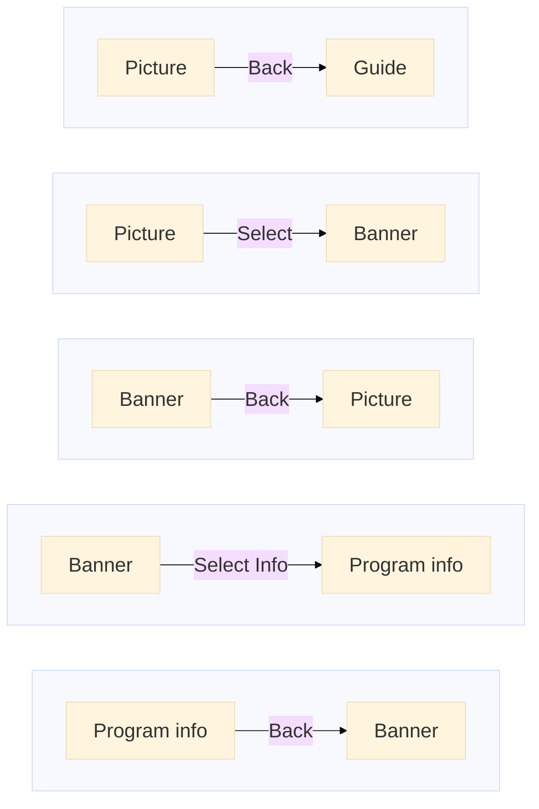

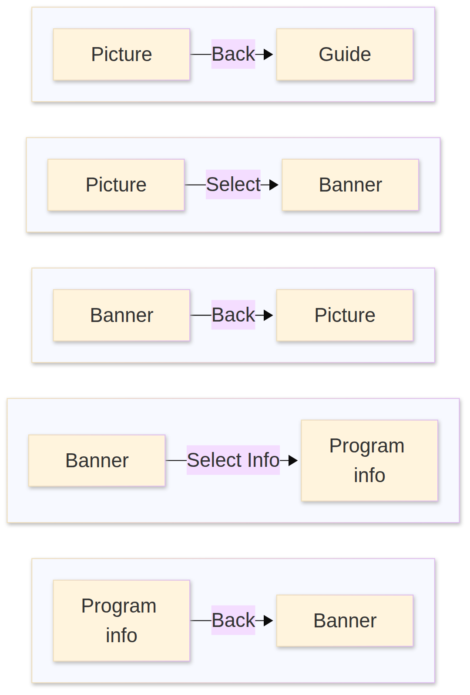

- Back from the picture or a pause opens the guide. It does not leave the app.
- Select on the picture opens the actions banner. While paused, Select plays.
- Back on the banner closes it. Back on program info returns to the banner. Back on a track picker returns to its chip.
- Select on the banner presses the focused button: Info, Last, Live, or a chip.
- Numpad Enter is not Select on this screen.

## Guide

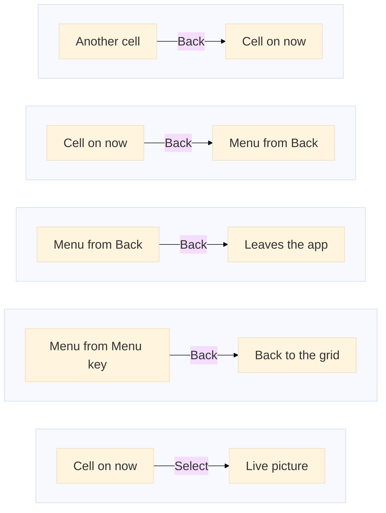

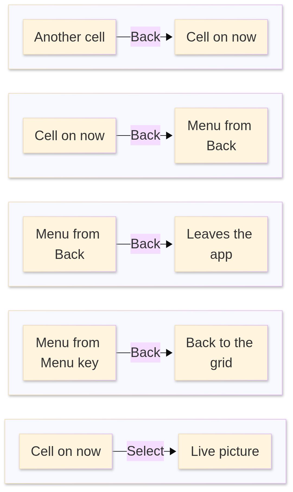

- Back from another cell jumps to the programme that is on now.
- Back from that cell opens the menu. Back from a menu that Back opened leaves the app.
- A menu opened with the Menu key closes on Back and stays in the guide.
- Select on a programme tunes that channel. Select on Settings, Channels, or Exit opens that screen, or leaves.
- While the guide is still loading, Back leaves the app.

## Channels and builder

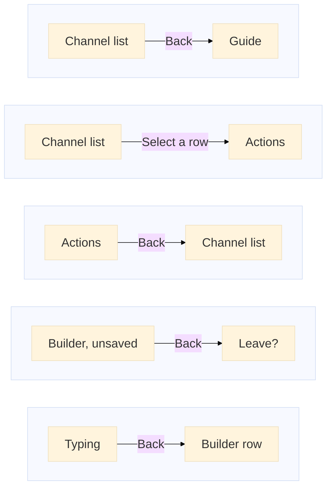

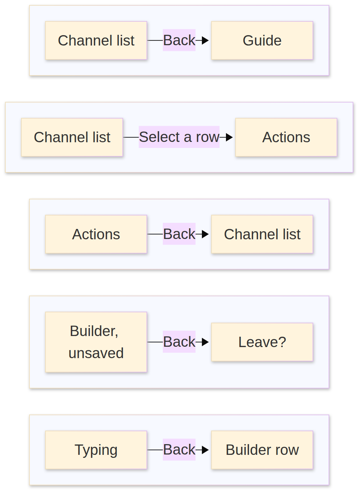

- Back from the channel list returns to the guide.
- Select on a row opens its actions. Select on New opens the builder.
- Back closes a panel, the number picker, or a question before it leaves.
- A builder with unsaved work asks before it closes. Back while typing only puts the keyboard away.
- The properties sheet uses this same path. Watch tunes that channel and closes the sheet.

## Settings

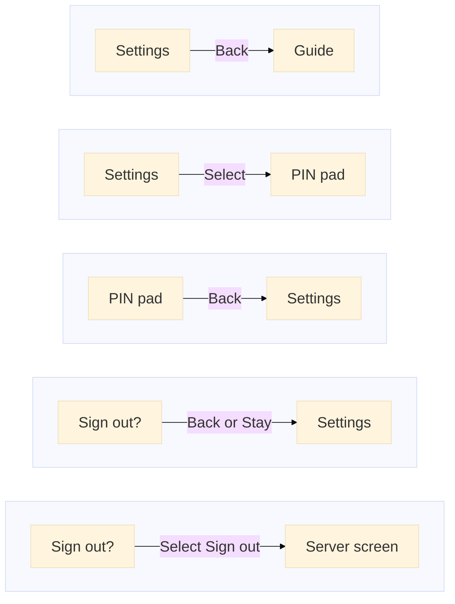

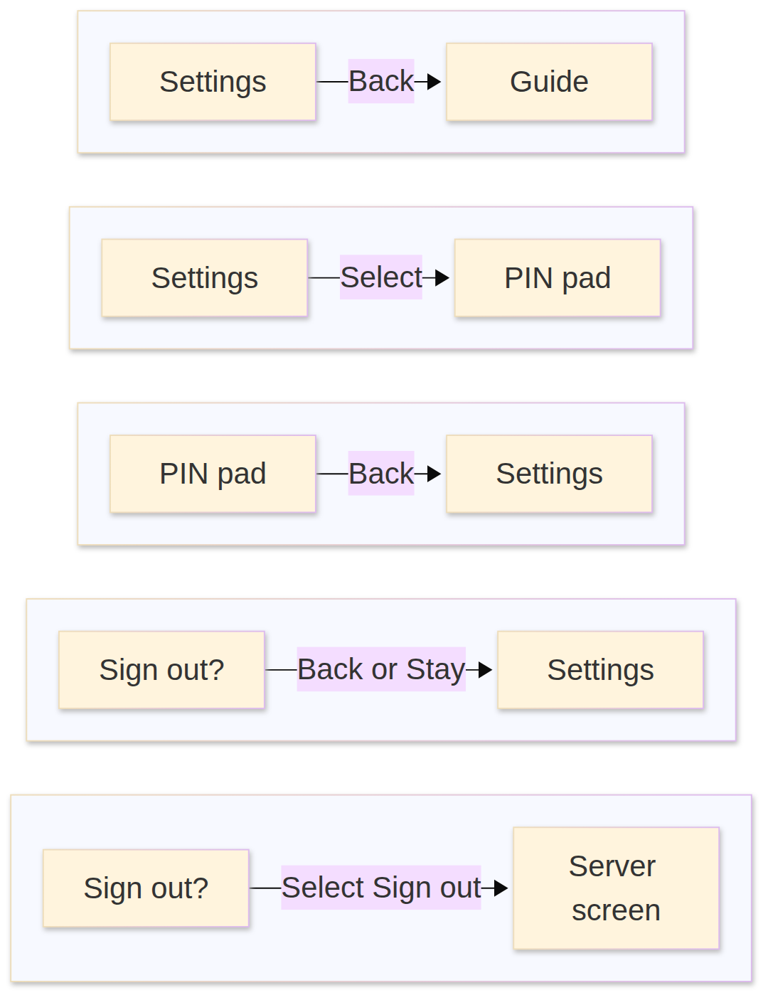

- Back closes the sheet and returns to the guide.
- Select on Kids Mode or Change PIN opens the PIN pad. Back there cancels it.
- Select on Hours, Libraries, or Pro opens that screen. Back returns to the sheet.
- Sign out asks first. Back, or Stay, keeps the sign-in. Sign out goes to the server screen.
- While sign-out is running, Back and Select do nothing.

## Onboarding

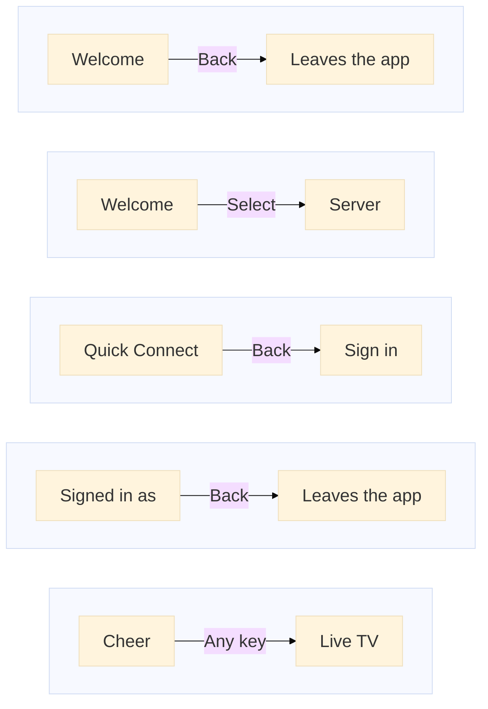

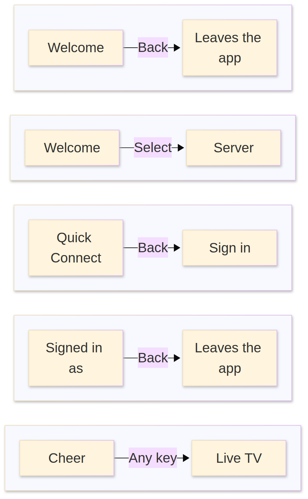

- Welcome's Back leaves the app. Get started opens the server screen.
- Back from the server returns to Welcome when Welcome is underneath. When the server screen is the only one, Back leaves the app.
- Back from sign-in returns to the server. During Quick Connect, Back only cancels Quick Connect.
- Back from the library picker opens Signed in as. Back there leaves the app. Continue returns to the picker.
- Back during first sync leaves the app. On the cheer, any key continues to live TV.

## Full chart

The phone charts drop conditions. The full map is one chart, and the audit is the table with file and line for every state.

- [Full chart, PNG](back-select-flow.png)
- [Full chart, SVG](back-select-flow.svg)
- [Full chart source](back-select-flow.mmd)
- [Audit: table and findings](back-select-audit.md)

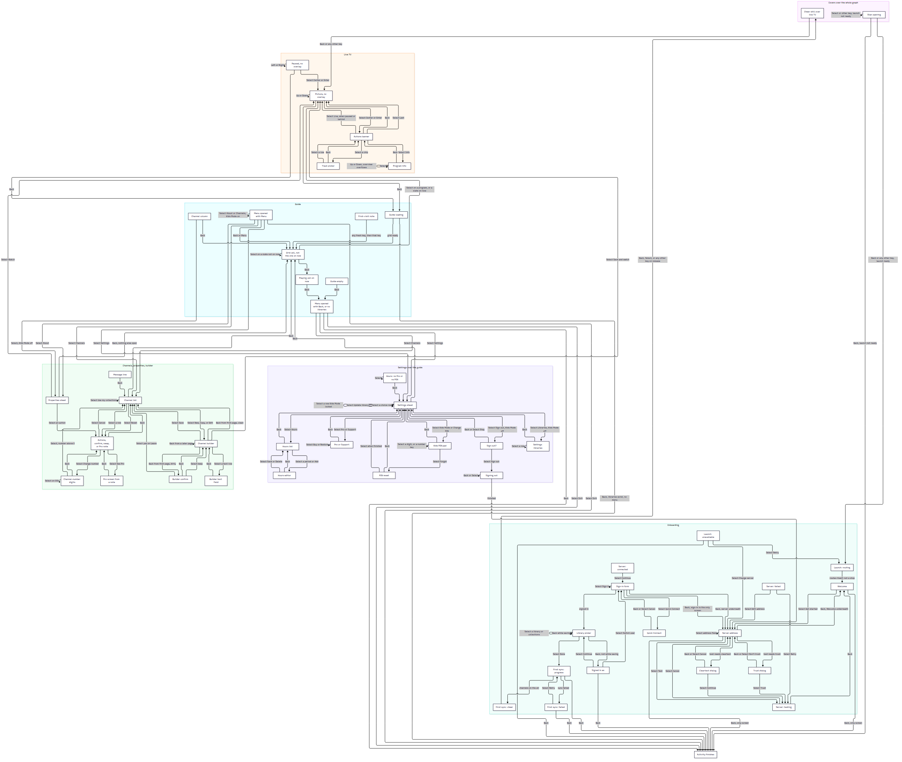
